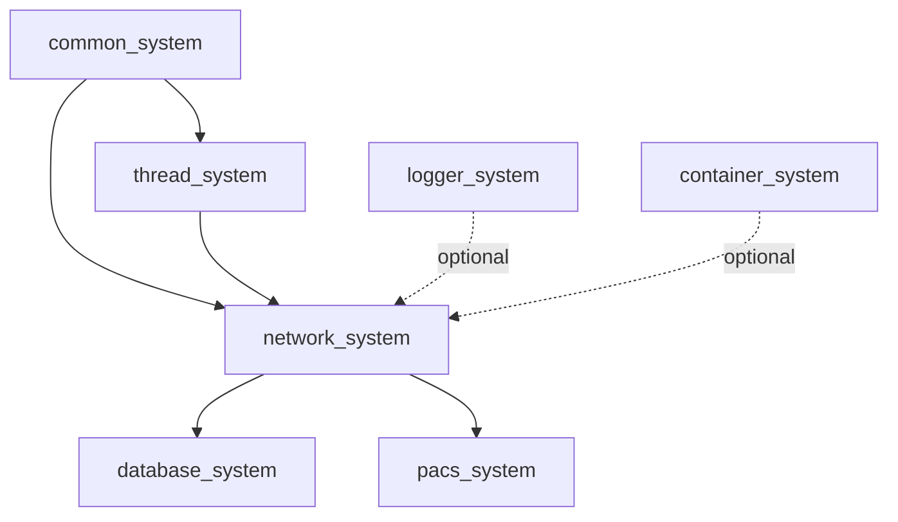

[](https://github.com/kcenon/network_system/actions/workflows/ci.yml)
[](https://github.com/kcenon/network_system/actions/workflows/code-quality.yml)
[](https://github.com/kcenon/network_system/actions/workflows/coverage.yml)
[](https://codecov.io/gh/kcenon/network_system)
[](https://github.com/kcenon/network_system/actions/workflows/build-Doxygen.yaml)
[](https://github.com/kcenon/network_system/blob/main/LICENSE)

# Network System

> **Language:** [English](README.md) | **한국어**

## 목차

- [개요](#개요)
- [vcpkg를 통한 설치](#vcpkg를-통한-설치)
- [요구사항](#요구사항)
- [빠른 시작](#빠른-시작-1)
- [모듈식 아키텍처](#모듈식-아키텍처-신규)
- [핵심 기능](#핵심-기능)
- [성능 하이라이트](#성능-하이라이트)
- [아키텍처 개요](#아키텍처-개요)
- [생태계 통합](#생태계-통합)
- [문서](#문서)
- [플랫폼 지원](#플랫폼-지원)
- [프로덕션 품질](#프로덕션-품질)
- [빌드 옵션](#빌드-옵션)
- [예제](#예제)
- [로드맵](#로드맵)
- [기여하기](#기여하기)
- [라이선스](#라이선스)

---

## 개요

분산 시스템과 메시징 애플리케이션을 위한 재사용 가능한 전송 프리미티브를 제공하는 현대적인 C++20 비동기 네트워크 라이브러리입니다. 향상된 모듈성과 생태계 전반의 재사용성을 위해 messaging_system에서 추출되었습니다.

**주요 특징**:
- 🏗️ **모듈식 아키텍처**: 플러그인 가능한 프로토콜 스택을 갖춘 코루틴 친화적 비동기 I/O
- ⚡ **고성능**: ASIO 기반 논블로킹 연산; [과거 CPU 전용 allocation/copy 벤치마크](docs/BENCHMARKS.md#synthetic-benchmarks)에서 64바이트 페이로드 기준 ~769K msg/s
- 🛡️ **프로덕션 등급**: 포괄적인 새니타이저 커버리지(TSAN/ASAN/UBSAN 클린), RAII Grade A, 다중 플랫폼 CI/CD
- 🔒 **보안**: TLS 1.2/1.3 지원, 인증서 검증, 최신 암호화 스위트
- 🌐 **크로스 플랫폼**: GCC, Clang, MSVC 지원과 함께 Ubuntu, Windows, macOS

> **버전 상태 — v1.0 후보(태그 보류 중).** 현재 패키지 버전은 **`0.1.1`**입니다
> (`CMakeLists.txt` 및 `vcpkg.json` 참조). 공개 API 표면은 감사를 거쳐 *v1.0
> 후보로 동결*되었으나(자세한 내용은
> [docs/v1.0-api-surface.md](docs/v1.0-api-surface.md) 참조), **v1.0.0은 아직
> 릴리스되지 않았으며 `v1.0.0` 태그도 발행되지 않았습니다.** 태그 발행은
> [#1165](https://github.com/kcenon/network_system/issues/1165)의 릴리스 정책 작업
> (커버리지 정책 및 상위 프로젝트 릴리스 선행 조건)과 준비 상태 epic
> [#964](https://github.com/kcenon/network_system/issues/964)에서 추적됩니다.
> v1.0.0이 태깅되기 전까지 `network_system`은 pre-1.0으로
> 취급하십시오. 아래 설명된 SemVer 안정성 보장은 태그가 발행된 이후에만
> 적용됩니다.

> **발행된 릴리스:** [v0.1.1](https://github.com/kcenon/network_system/releases/tag/v0.1.1).
> 해당 태그의 CMake 버전은 `0.1.1`이지만 두 vcpkg 매니페스트는 여전히
> `0.1.0`입니다. 소스 비교와 다음 릴리스 요건은
> [릴리스 정정 안내 및 정책](ci/RELEASE_POLICY.md#published-versions-and-historical-erratum)을 참조하십시오.

---

## vcpkg를 통한 설치

### 빠른 시작

```bash
# Using overlay ports from the kcenon vcpkg registry
vcpkg install kcenon-network-system \
  --overlay-ports=path/to/kcenon/vcpkg-registry/ports

# Optional logger integration (TLS is a core dependency)
vcpkg install "kcenon-network-system[logging]" \
  --overlay-ports=path/to/kcenon/vcpkg-registry/ports
```

> **레지스트리 기반 소비**: 이미 [kcenon/vcpkg-registry](https://github.com/kcenon/vcpkg-registry)를 사용하는 프로젝트라면, `vcpkg-configuration.json`에 레지스트리를 추가하고 `--overlay-ports` 없이 설치하세요.

### 기능 매트릭스

아래 표는 [레지스트리 포트](https://github.com/kcenon/vcpkg-registry/blob/main/ports/kcenon-network-system/vcpkg.json)의 기능입니다. 레지스트리는 게시된 `v0.1.1` 소스를 사용합니다. 이 저장소의 루트 개발 매니페스트에 있는 `ssl`, `ecosystem`, `testing`, `samples`, `docs`는 소비자 포트의 기능이 아닙니다.

| 기능 | 기본값 | 설명 |
|------|--------|------|
| core | 항상 | common_system, thread_system, ASIO, OpenSSL, zlib |
| `logging` | 끔 | 선택적 logger_system 통합 |

이하 CMake 및 C++ 예제는 **현재 `main`을 소스에서 빌드하고 설치한 패키지**를 대상으로 합니다. 게시된 태그에 현재 API가 모두 포함되어 있다고 가정하지 마세요. 의존성 패키지를 먼저 설치한 뒤 아래 소스 빌드 절차를 따르세요.

### CMake 통합

```cmake
cmake_minimum_required(VERSION 3.20)
project(readme_example LANGUAGES CXX)
find_package(network_system CONFIG REQUIRED)
add_executable(readme_example main.cpp)
target_compile_features(readme_example PRIVATE cxx_std_20)
target_link_libraries(readme_example PRIVATE network_system::network_system)
```

표준 내보내기 타깃은 `network_system::network_system`입니다. 이 이름은 다운스트림 소비자를 위한 v1.0 안정 계약 타깃으로 의도되었으며(v1.0 보장은 v1.0.0 태그가 발행된 이후에 효력이 발생합니다 — 위의 버전 상태 노트 참조), 빌드 트리(FetchContent / add_subdirectory)와 설치 트리(`find_package`) 소비 양쪽에서 이미 일관되게 제공됩니다. 더 이상 사용되지 않는 타깃 표기는 내보내지지 않습니다.

`main.cpp`에 아래 C++ 예제 중 하나를 저장하고 위 내용을 `CMakeLists.txt`로 저장하세요. `CMAKE_PREFIX_PATH`에 network_system과 의존성 설치 경로를 지정하세요.

```bash
cmake -S . -B build -DCMAKE_PREFIX_PATH="/path/to/network/install;/path/to/dependency/prefix"
cmake --build build --parallel
```

### 최소 예제

```cpp
#include <kcenon/network/facade/tcp_facade.h>
#include <iostream>

int main() {
    kcenon::network::facade::tcp_facade tcp;
    auto created = tcp.create_server({.port = 9090});
    if (created.is_err()) {
        std::cerr << created.error().message << '\n';
        return 1;
    }
    auto server = created.value();
    auto started = server->start(9090);
    if (started.is_err()) {
        std::cerr << started.error().message << '\n';
        return 1;
    }
    std::cout << "Listening on port 9090; press Enter to stop." << std::endl;
    std::cin.get();
    auto stopped = server->stop();
    return stopped.is_err() ? 1 : 0;
}
```

---

## 요구사항

| 의존성 | 버전 | 필수 | 설명 |
|------------|---------|----------|-------------|
| C++20 컴파일러 | GCC 13+ / Clang 17+ / MSVC 2022+ / Apple Clang 14+ | 예 | thread_system 의존성으로 인한 상향 요구사항 |
| CMake | 3.20+ | 예 | 빌드 시스템 |
| ASIO | 1.30.2+ | 예 | 비동기 I/O (standalone) |
| OpenSSL | 3.0+ | 예 | TLS/SSL 지원 |
| [common_system](https://github.com/kcenon/common_system) | latest | 예 | 공통 인터페이스 및 Result<T> |
| [thread_system](https://github.com/kcenon/thread_system) | latest | 예 | 스레드 풀 및 비동기 연산 |
| [logger_system](https://github.com/kcenon/logger_system) | latest | 선택 | 기본 OFF; common_system ILogger로 런타임 바인딩 |
| [container_system](https://github.com/kcenon/container_system) | latest | 선택 | CMake 기본 ON; 패키지가 없으면 비활성화 |

> **OpenSSL 참고**: 기본 TLS 빌드는 OpenSSL 3.0 이상을 요구합니다.

### 의존성 흐름

```
network_system
├── common_system (required)
├── thread_system (required)
│   └── common_system
├── logger_system (optional, default OFF)
│   └── common_system
└── container_system (optional, default ON)
    └── common_system
```

> **참고**: database_system과 달리 network_system은 monitoring_system에 대한 컴파일 타임 의존성을 가지지 **않습니다**. 관측성을 위해 network_system은 common_system을 통한 EventBus 기반 메트릭 발행을 사용합니다. 외부 모니터링 소비자(monitoring_system 포함)는 메트릭 수집을 위해 `network_metric_event`를 구독할 수 있습니다. 자세한 내용은 [모니터링 통합 가이드](docs/integration/with-monitoring.md)를 참고하세요.

### 의존성과 함께 빌드

소스 빌드 전에 `common_system`, `thread_system`, ASIO의 CMake 패키지와 OpenSSL/zlib를 설치하세요. `CMAKE_PREFIX_PATH`는 실제 설치 경로로 바꾸세요. 소스 저장소를 복제하는 것만으로 정적 라이브러리가 빌드되지는 않습니다. 선택적 logger/container 통합은 이 절차에서 끕니다.

```bash
git clone --branch main https://github.com/kcenon/network_system.git
cd network_system
cmake -S . -B build -G Ninja -DCMAKE_BUILD_TYPE=Release \
  -DCMAKE_PREFIX_PATH="/path/to/dependency/prefix" \
  -DBUILD_TESTS=OFF -DBUILD_EXAMPLES=OFF \
  -DKCENON_WITH_LOGGER_SYSTEM=OFF -DKCENON_WITH_CONTAINER_SYSTEM=OFF
cmake --build build --parallel
cmake --install build --prefix "$HOME/.local"
```

📖 **[빠른 시작 가이드 →](docs/guides/QUICK_START.md)**

---

## 빠른 시작

### 사전 준비

아래 명령은 시스템 라이브러리를 설치합니다. 배포판 패키지 버전이 요구사항을 충족하는지 확인하고, C++ 컴파일러와 common_system/thread_system/ASIO CMake 패키지는 별도로 준비하세요.

**Ubuntu/Debian** (Ubuntu 22.04+는 기본적으로 OpenSSL 3.x 제공):
```bash
sudo apt update
sudo apt install -y cmake ninja-build libasio-dev libssl-dev liblz4-dev zlib1g-dev
```

**macOS** (Homebrew를 통한 OpenSSL 3.x):
```bash
brew install cmake ninja asio openssl@3 lz4 zlib
```

**Windows (vcpkg)**:
```powershell
# vcpkg provides OpenSSL 3.x
vcpkg install openssl asio lz4 zlib --triplet x64-windows
```

**Windows (MSYS2)**:
```bash
pacman -S mingw-w64-x86_64-cmake mingw-w64-x86_64-ninja \
          mingw-w64-x86_64-asio mingw-w64-x86_64-openssl
```

### 빌드

위의 의존성 설치 및 소스 빌드 절차를 사용하세요. C++ 예제는 설치된 패키지를 사용하는 별도 소비자 프로젝트에서 빌드합니다.

### C++20 모듈 빌드 (실험적)

`NETWORK_BUILD_MODULES`는 별도의 실험적 모듈 타깃을 활성화합니다. CMake 3.28 이상과 모듈 지원 도구 체인이 필요하며, 헤더 API와 같은 사용법을 보장하지 않습니다. 현재 모듈 인터페이스는 [src/modules](src/modules/)를 참조하세요. 아래 빠른 시작 예제는 헤더 API를 사용합니다.

### 첫 서버 (60초)

```cpp
#include <kcenon/network/network_system.h>
#include <iostream>
#include <memory>

int main() {
    auto server = std::make_shared<kcenon::network::core::messaging_server>("MyServer");

    auto result = server->start_server(8080);
    if (result.is_err()) {
        const auto& err = result.error();
        std::cerr << "Failed to start: " << err.message
                  << " (code: " << err.code << ")" << std::endl;
        return -1;
    }

    std::cout << "Server running on port 8080; press Enter to stop." << std::endl;
    std::cin.get();
    auto stopped = server->stop_server();
    return stopped.is_err() ? 1 : 0;
}
```

### 첫 클라이언트

```cpp
#include <kcenon/network/network_system.h>
#include <chrono>
#include <cstdint>
#include <iostream>
#include <memory>
#include <string>
#include <thread>
#include <utility>
#include <vector>

int main() {
    auto client = std::make_shared<kcenon::network::core::messaging_client>("MyClient");

    auto result = client->start_client("127.0.0.1", 8080);
    if (result.is_err()) {
        const auto& err = result.error();
        std::cerr << "Failed to connect: " << err.message
                  << " (code: " << err.code << ")" << std::endl;
        return -1;
    }

    // start_client initiates an asynchronous connection. Wait before sending.
    const auto deadline = std::chrono::steady_clock::now() + std::chrono::seconds(5);
    while (!client->is_connected() && std::chrono::steady_clock::now() < deadline) {
        std::this_thread::sleep_for(std::chrono::milliseconds(10));
    }
    if (!client->is_connected()) {
        std::cerr << "Connection timed out\n";
        (void)client->stop_client();
        return 1;
    }

    // Send message (std::move avoids extra copies)
    std::string message = "Hello, Network System!";
    std::vector<uint8_t> data(message.begin(), message.end());

    auto send_result = client->send_packet(std::move(data));
    if (send_result.is_err()) {
        const auto& err = send_result.error();
        std::cerr << "Failed to send: " << err.message
                  << " (code: " << err.code << ")" << std::endl;
    }

    std::cout << "Press Enter to stop the client." << std::endl;
    std::cin.get();
    auto stopped = client->stop_client();
    return send_result.is_err() || stopped.is_err() ? 1 : 0;
}
```

### 간소화된 Facade API

더욱 간단한 사용을 위해 템플릿 복잡도를 숨기는 Facade API를 사용하세요:

```cpp
#include <kcenon/network/facade/tcp_facade.h>
#include <iostream>

int main() {
    kcenon::network::facade::tcp_facade tcp;
    auto created = tcp.create_server({.port = 8080});
    if (created.is_err()) {
        std::cerr << created.error().message << '\n';
        return 1;
    }
    auto server = created.value();
    server->set_receive_callback([](auto session_id, const auto& data) {
        std::cout << "Received " << data.size() << " bytes from "
                  << session_id << std::endl;
    });
    auto started = server->start(8080);
    if (started.is_err()) {
        std::cerr << started.error().message << '\n';
        return 1;
    }
    std::cout << "Listening on port 8080; press Enter to stop." << std::endl;
    std::cin.get();
    auto stopped = server->stop();
    return stopped.is_err() ? 1 : 0;
}
```

**장점:**
- ✅ 템플릿 파라미터 없음
- ✅ 명확한 설정 구조체
- ✅ 프로토콜 비종속 인터페이스
- ✅ 직접 API와 동일한 성능

📖 **[전체 Facade 문서 →](docs/facades/README.md)**

---

## 모듈식 아키텍처 (신규)

현재 소스 트리에서 network_system은 유지보수성과 선택적 링크 향상을 위해 프로토콜별 라이브러리로 구성됩니다.

### 라이브러리 개요

| 라이브러리 | 설명 | 의존성 |
|---------|-------------|--------------|
| [`network-core`](libs/network-core/) | 핵심 인터페이스 및 세션 관리 | None |
| [`network-tcp`](libs/network-tcp/) | SSL/TLS 지원 TCP 프로토콜 | network-core, ASIO, OpenSSL |
| [`network-udp`](libs/network-udp/) | UDP 데이터그램 프로토콜 | network-core, ASIO |
| [`network-websocket`](libs/network-websocket/) | WebSocket (RFC 6455) | network-tcp |
| [`network-http2`](libs/network-http2/) | HTTP/2 멀티플렉스 프로토콜 | network-websocket |
| [`network-quic`](libs/network-quic/) | QUIC (RFC 9000) | network-udp, OpenSSL |
| [`network-grpc`](libs/network-grpc/) | gRPC 고성능 RPC | network-quic |
| [`network-all`](libs/network-all/) | 엄브렐러 패키지 (모든 프로토콜) | 위의 모든 것 |

### 프로토콜 지원 상태

프로토콜별 감사된 지원 상태입니다 (전체 매트릭스, 근거, 코드 수준 발견 사항은
[docs/PROTOCOL_SUPPORT.md](docs/PROTOCOL_SUPPORT.md) 참조):

| 프로토콜 | 상태 | 비고 |
|----------|--------|-------|
| TCP | `production` | 비동기 서버/클라이언트, 수명 주기, 재연결 |
| UDP | `production` | 비연결형 데이터그램, 브로드캐스트/멀티캐스트 |
| TLS/SSL | `production` | TLS 1.2/1.3, 인증서 검증 |
| WebSocket | `production` | RFC 6455 프레이밍, 분할, ping/pong |
| HTTP/1.1 | `production` | 라우팅, 쿠키, multipart, gzip/deflate |
| HTTP/2 | `production` | 멀티플렉스 스트림; HPACK Huffman 코딩 (프로토콜 지원 표 참조) |
| QUIC | `production` | RFC 9000/9001/9002 코어; 실험적 클라이언트 stats/ALPN 접근자 |
| gRPC | `production` | 커스텀 HTTP/2 전송 + 선택적 `grpc++` 래퍼 |
| DTLS | `experimental` | 소켓 존재 및 테스트됨; 서버 페이로드 처리 미연결 |

`production` 프로토콜은 정상 경로 및 비정상 경로 테스트로 커버됩니다.
`experimental` 표면은 문서화되어 있으며 (후보) v1.0 안정성 표면에서
제외됩니다. v1.0 보장 자체는 v1.0.0 태그가 발행된 이후에만 효력이 발생합니다
([개요](#개요)의 버전 상태 노트 참조).

### 의존성 그래프

```
                    network-core
                    /    |    \
                   /     |     \
            network-tcp  |  network-udp
                  |      |      |
         network-websocket    network-quic
                  |             |
              network-http2  network-grpc
```

### 선택적 링크

애플리케이션에 필요한 프로토콜만 링크하세요:

이 예제는 위와 같은 `main.cpp`/`CMakeLists.txt` 소비자 구조를 사용합니다. 최상위 설치는 `network_system` 패키지에 프로토콜 타깃을 함께 내보냅니다. 다음 블록은 TCP/UDP 헤더만 사용하는 프로그램용이며, 아래 umbrella 예제에는 `network_system::network_system` 타깃을 사용하세요.

```cmake
cmake_minimum_required(VERSION 3.20)
project(protocol_example LANGUAGES CXX)
find_package(network_system CONFIG REQUIRED)
add_executable(protocol_example main.cpp)
target_compile_features(protocol_example PRIVATE cxx_std_20)
target_link_libraries(protocol_example PRIVATE
    network_system::network-tcp
    network_system::network-udp
)
```

위 프로토콜 타깃으로 빌드할 `main.cpp`:

```cpp
#include <network_tcp/protocol/tcp.h>
#include <network_udp/protocol/udp.h>

int main() {
    auto tcp = kcenon::network::protocol::tcp::create_connection("readme-tcp");
    auto udp = kcenon::network::protocol::udp::create_connection("readme-udp");
    return tcp && udp ? 0 : 1;
}
```

### 엄브렐러 헤더

공개 통합 헤더로 코어 네트워킹을 포함하고 TCP 생성에는 facade 헤더를 사용하세요:

```cpp
#include <kcenon/network/network_system.h>
#include <kcenon/network/facade/tcp_facade.h>

int main() {
    kcenon::network::facade::tcp_facade tcp;
    auto server = tcp.create_server({.port = 8080});
    return server.is_err() ? 1 : 0;
}
```

📖 **[마이그레이션 가이드 →](docs/MIGRATION.md)** | **[라이브러리 README](libs/)**

---

## 핵심 기능

### 프로토콜

- **TCP**: 생명주기 관리를 갖춘 비동기 TCP 서버/클라이언트
  - 논블로킹 I/O, 자동 재연결, 헬스 모니터링
  - 멀티스레드 메시지 처리, 세션 관리

- **UDP**: 실시간 애플리케이션을 위한 비연결 UDP
  - 저지연 데이터그램 전송, 브로드캐스트/멀티캐스트 지원

- **TLS/SSL**: 보안 통신 (TLS 1.2/1.3)
  - 최신 암호화 스위트 (AES-GCM, ChaCha20-Poly1305)
  - 인증서 검증, 순방향 비밀성 (ECDHE)

- **WebSocket**: RFC 6455 준수
  - 텍스트 및 바이너리 메시지 프레이밍, ping/pong keepalive
  - 단편화/재조립, 우아한 연결 생명주기

- **HTTP/1.1**: 고급 기능을 갖춘 서버 및 클라이언트
  - 라우팅, 쿠키, multipart/form-data, 청크 인코딩
  - 자동 압축 (gzip/deflate)

- **QUIC**: RFC 9000/9001/9002 준수
  - TLS 1.3 암호화를 갖춘 UDP 기반 멀티플렉스 전송
  - 스트림 멀티플렉싱, 0-RTT 연결 재개
  - 손실 감지 및 혼잡 제어
  - 연결 마이그레이션 지원

- **gRPC**: 고성능 RPC 프레임워크 (신규)
  - network_system 통합을 갖춘 공식 gRPC 라이브러리 래퍼
  - 동적 메서드 등록을 갖춘 서비스 레지스트리
  - 모든 스트리밍 모드 (unary, server, client, bidirectional)
  - 헬스 체크 및 리플렉션 지원
  - Result<T>에서 gRPC Status로의 변환

📖 **[상세 프로토콜 문서 →](docs/FEATURES.md)**
📖 **[gRPC 가이드 →](docs/guides/GRPC_GUIDE.md)**

### 분산 추적

관측성을 위한 OpenTelemetry 호환 분산 추적:

- **W3C Trace Context**: 서비스 경계를 넘는 표준 컨텍스트 전파
- **RAII Span**: `NETWORK_TRACE_SPAN` 매크로를 통한 자동 span 생명주기 관리
- **익스포터**: Console 및 OTLP HTTP; 다른 백엔드의 제한은 [프로토콜 지원 표](docs/PROTOCOL_SUPPORT.md) 참조
- **샘플링**: always-on, always-off, trace-id 기반, parent 기반 샘플러
- **풍부한 속성**: 문자열, 정수, 실수, 불리언 속성 및 이벤트

```cpp
#include <kcenon/network/tracing/tracing.h>

using namespace kcenon::network::tracing;

void process_request() {
    NETWORK_TRACE_SPAN("http.request.process");
    _span.set_attribute("http.method", "POST");
    _span.set_attribute("http.url", "/api/orders");
    {
        auto db_span = trace_context::current().create_child_span("database.query");
        db_span.set_attribute("db.system", "postgresql");
        db_span.set_status(span_status::ok);
    }
    _span.set_status(span_status::ok);
}

int main() {
    auto config = tracing_config::console();
    config.service_name = "my-service";
    configure_tracing(config);
    process_request();
    shutdown_tracing();
}
```

📖 **[추적 가이드 →](docs/guides/tracing.md)**

### 비동기 모델

- **ASIO 기반**: 비동기 연산을 갖춘 논블로킹 이벤트 루프
- **C++20 코루틴**: 선택적 코루틴 기반 비동기 헬퍼
- **C++20 Concepts**: 명확한 오류 메시지를 갖춘 컴파일 타임 타입 검증
- **파이프라인 아키텍처**: 압축/암호화 훅을 갖춘 메시지 변환
- **Move 시맨틱**: Zero-copy 친화적 API (move-aware 버퍼 처리)

### 실패 처리
- 모든 서버/클라이언트 시작 헬퍼는 `Result<void>`를 반환합니다. 계속 진행하기 전에 `result.is_err()`를 확인하고 `result.error().message`를 로깅하세요.
- 과거 수정 사항(세션 정리, 백프레셔, TLS 롤아웃)에 대해서는 [설계 결정](docs/DESIGN_DECISIONS.md)과 [이슈 트래커](https://github.com/kcenon/network_system/issues)를 참조하세요.
- 상위 수준 서비스를 구축할 때는 `common::error_info`를 스택 위로 전파하여 모니터링 및 알림 파이프라인이 계층 간 실패를 상관시킬 수 있도록 하세요.

### 오류 처리

**Result<T> 패턴** (75-80% 마이그레이션됨):
다음 코드는 위 서버 예제의 `main()` 안에서 `server` 생성 직후에 들어가는 오류 처리 부분입니다.

```cpp
auto result = server->start_server(8080);
if (result.is_err()) {
    const auto& err = result.error();
    std::cerr << "Error: " << err.message
              << " (code: " << err.code << ")\n";
    return -1;
}
```

**오류 코드** (-600 ~ -699):
- Connection (-600 ~ -619): `connection_failed`, `connection_refused`, `connection_timeout`
- Session (-620 ~ -639): `session_not_found`, `session_expired`
- Send/Receive (-640 ~ -659): `send_failed`, `receive_failed`, `message_too_large`
- Server (-660 ~ -679): `server_not_started`, `server_already_running`, `bind_failed`

---

## 성능 하이라이트

### 합성 벤치마크 (Intel i7-12700K, Ubuntu 22.04, GCC 11, `-O3`)

이는 [벤치마크 기록](docs/BENCHMARKS.md#synthetic-benchmarks)의 과거 GCC 11.3 측정값이며 현재 소스의 GCC 13 이상 요구사항과 별개입니다. 네트워크 I/O 처리량이 아닌 CPU 전용 allocation/memcpy 결과입니다.

| 페이로드 | 처리량 | 지연 시간 (ns/op) | 범위 |
|---------|-----------|-----------------|-------|
| 64 bytes | ~769K msg/s | 1,300 | CPU 전용 (할당 + memcpy) |
| 256 bytes | ~305K msg/s | 3,270 | CPU 전용 (할당 + memcpy) |
| 1 KB | ~128K msg/s | 7,803 | CPU 전용 (할당 + memcpy) |
| 8 KB | ~21K msg/s | 48,000 | CPU 전용 (할당 + memcpy) |

### 실제 I/O 벤치마크 (루프백 TCP)

| 벤치마크 | 페이로드 | 범위 |
|-----------|---------|-------|
| TCP Connection Establish | N/A | 루프백을 통한 연결 + 연결 해제 |
| TCP Echo Roundtrip | 64B, 1KB, 8KB | 커널 TCP 스택을 통한 송신 + 수신 |
| TCP Stream Throughput | 1KB, 64KB | 루프백을 통한 지속 bytes/sec |

**참고**: 합성 벤치마크는 실제 네트워크 I/O 없이 CPU 전용 연산을 측정합니다. 실제 I/O 벤치마크는 루프백 인터페이스의 TCP 에코 서버를 사용하여 실제 커널 TCP 스택 오버헤드를 측정합니다.

### 벤치마크 재현

벤치마크 타깃은 Google Benchmark 패키지를 찾을 때만 생성됩니다. `NETWORK_BUILD_BENCHMARKS=ON`만 지정해도 의존성이 설치되는 것은 아닙니다. [벤치마크 소스와 CMake 설정](benchmarks/) 및 [측정 방법](docs/BENCHMARKS.md)을 참조하세요.

⚡ **[전체 벤치마크 및 부하 테스트 →](docs/BENCHMARKS.md)**

**플랫폼**: Apple M1 @ 3.2GHz (Apple Silicon에서 테스트한 경우)

---

## 아키텍처 개요

```
┌─────────────────────────────────────────────────────────────────┐
│                    Network System Architecture                  │
├─────────────────────────────────────────────────────────────────┤
│  Public API Layer                                               │
│  ┌──────────────┐ ┌──────────────┐ ┌──────────────────────┐    │
│  │ messaging    │ │ messaging    │ │  messaging_ws        │    │
│  │ _server      │ │ _client      │ │  _server / _client   │    │
│  │ (TCP)        │ │ (TCP)        │ │  (WebSocket)         │    │
│  └──────────────┘ └──────────────┘ └──────────────────────┘    │
│  ┌──────────────────────┐ ┌─────────────────────────┐          │
│  │ secure_messaging     │ │ secure_messaging        │          │
│  │ _server (TLS/SSL)    │ │ _client (TLS/SSL)       │          │
│  └──────────────────────┘ └─────────────────────────┘          │
│  ┌──────────────────────┐ ┌─────────────────────────┐          │
│  │ messaging_quic       │ │ messaging_quic          │          │
│  │ _server (QUIC)       │ │ _client (QUIC)          │          │
│  └──────────────────────┘ └─────────────────────────┘          │
├─────────────────────────────────────────────────────────────────┤
│  Protocol Layer                                                 │
│  ┌──────────────┐ ┌──────────────┐ ┌──────────────────────┐    │
│  │ tcp_socket   │ │ udp_socket   │ │ websocket_socket     │    │
│  └──────────────┘ └──────────────┘ └──────────────────────┘    │
│  ┌──────────────────────┐ ┌──────────────────────────────┐     │
│  │ secure_tcp_socket    │ │ websocket_protocol           │     │
│  │ (SSL stream wrapper) │ │ (frame/handshake/msg handle) │     │
│  └──────────────────────┘ └──────────────────────────────┘     │
│  ┌──────────────────────────────────────────────────────────┐  │
│  │ protocols/quic/ (RFC 9000/9001/9002)                     │  │
│  │ connection, stream, packet, frame, crypto, varint        │  │
│  └──────────────────────────────────────────────────────────┘  │
├─────────────────────────────────────────────────────────────────┤
│  Session Management Layer                                       │
│  ┌──────────────┐ ┌──────────────┐ ┌────────────────────────┐  │
│  │ messaging    │ │ secure       │ │ ws_session_manager     │  │
│  │ _session     │ │ _session     │ │ (WebSocket mgmt)       │  │
│  │ (TCP)        │ │ (TLS/SSL)    │ │                        │  │
│  └──────────────┘ └──────────────┘ └────────────────────────┘  │
│  ┌────────────────────────────────────────────────────────────┐│
│  │ quic_session (QUIC session management)                     ││
│  └────────────────────────────────────────────────────────────┘│
├─────────────────────────────────────────────────────────────────┤
│  Core Network Engine (ASIO-based)                              │
│  ┌─────────────┐ ┌─────────────┐ ┌─────────────┐              │
│  │ io_context  │ │   async     │ │  Result<T>  │              │
│  │             │ │  operations │ │   pattern   │              │
│  └─────────────┘ └─────────────┘ └─────────────┘              │
└─────────────────────────────────────────────────────────────────┘
```

**디자인 패턴**: Factory, Observer, Strategy, RAII, Template Metaprogramming

🏛️ **[상세 아키텍처 가이드 →](docs/ARCHITECTURE.md)**

---

## 생태계 통합

### 생태계 의존성 맵



> **생태계 참조**:
> [common_system](https://github.com/kcenon/common_system) — Result&lt;T&gt;, 인터페이스, 공유 유틸리티
> [thread_system](https://github.com/kcenon/thread_system) — 스레드 풀 및 비동기 실행 프리미티브
> [container_system](https://github.com/kcenon/container_system) — 타입 안전 데이터 직렬화
> [logger_system](https://github.com/kcenon/logger_system) — 로깅 인프라
> [database_system](https://github.com/kcenon/database_system) — 데이터베이스 연산 (network_system에 의존)
> [pacs_system](https://github.com/kcenon/pacs_system) — DICOM/PACS 시스템 (network_system 소비)

### 관련 프로젝트

이 시스템은 다음과 매끄럽게 통합됩니다:

- **[messaging_system](https://github.com/kcenon/messaging_system)**: 고성능 메시지 라우팅 및 전달
- **[container_system](https://github.com/kcenon/container_system)**: 타입 안전 데이터 직렬화 (MessagePack, FlatBuffers)
- **[thread_system](https://github.com/kcenon/thread_system)**: 동시 연산을 위한 스레드 풀 관리
- **[logger_system](https://github.com/kcenon/logger_system)**: 포괄적인 네트워크 진단 및 로깅
- **[database_system](https://github.com/kcenon/database_system)**: 네트워크 기반 데이터베이스 연산 및 클러스터링

### 통합 예제

```cpp
#include <kcenon/network/integration/thread_integration.h>
#include <iostream>
#include <memory>

int main() {
    using namespace kcenon::network::integration;
    auto pool = std::make_shared<basic_thread_pool>(2);
    auto& manager = thread_integration_manager::instance();
    manager.set_thread_pool(pool);
    manager.submit_task([] { std::cout << "Task completed\n"; }).get();
    std::cout << "Workers: " << manager.get_metrics().worker_threads << '\n';
    pool->stop();
}
```

### 사용자 정의 스레드 풀

외부 실행기를 연결하려면 공개 `integration::thread_pool_interface`를 구현하고 `thread_integration_manager::set_thread_pool()`로 등록하세요. 위 예제는 제공되는 `basic_thread_pool`을 사용합니다. `src/internal/integration`의 어댑터는 공개 API가 아니므로 애플리케이션에서 직접 포함하지 마세요.

🌐 **[전체 통합 가이드 →](docs/INTEGRATION.md)**

---

## 문서

### 시작하기
- 📖 [기능 가이드](docs/FEATURES.md) - 포괄적인 기능 설명
- 🏗️ [아키텍처](docs/ARCHITECTURE.md) - 시스템 설계 및 패턴
- 📘 [API 레퍼런스](docs/API_REFERENCE.md) - 완전한 API 문서
- 🔧 [빌드 가이드](docs/guides/BUILD.md) - 상세 빌드 지침
- 🚀 [마이그레이션 가이드](docs/MIGRATION.md) - messaging_system에서의 마이그레이션

#### 생성된 API 문서 (Doxygen)

(후보) v1.0 공개 API 표면에 대한 전체 Doxygen 생성 레퍼런스는 `main` 브랜치에서 [Generate-Documentation 워크플로](.github/workflows/build-Doxygen.yaml)에 의해 발행되며 GitHub Pages에 호스팅됩니다:

- https://kcenon.github.io/network_system/

HTML을 로컬에서 재생성하려면:

```bash
doxygen Doxyfile
# Output: documents/html/index.html
```

[Doxygen Warnings Check 워크플로](.github/workflows/doxygen-warnings-check.yml)는 `include/**`, `Doxyfile` 또는 해당 워크플로를 변경하는 PR과 `main`, `develop`, `phase-*` 푸시에서 실행되며 `include/kcenon/network/`(단, `detail/` 제외) 아래 헤더가 Doxygen 경고를 방출하면 빌드를 실패시킵니다. 이는 [docs/v1.0-api-surface.md](docs/v1.0-api-surface.md)에 정의된 v1.0 공개 API 표면을 문서 회귀로부터 보호합니다.

### 고급 주제
- ⚡ [성능 및 벤치마크](docs/BENCHMARKS.md) - 성능 메트릭 및 테스트
- 🏭 [프로덕션 품질](docs/PRODUCTION_QUALITY.md) - CI/CD, 보안, 품질 보증
- 📁 [프로젝트 구조](docs/PROJECT_STRUCTURE.md) - 디렉터리 구성 및 모듈
- 🧩 [C++20 Concepts](docs/advanced/CONCEPTS.md) - 컴파일 타임 타입 검증
- 🔒 [TLS 설정 가이드](docs/guides/TLS_SETUP_GUIDE.md) - TLS/SSL 구성
- 🔍 [문제 해결](docs/guides/TROUBLESHOOTING.md) - 일반적인 문제 및 해결책
- 🧪 [부하 테스트 가이드](docs/guides/LOAD_TEST_GUIDE.md) - 부하 테스트 절차
- 📝 [설계 결정](docs/DESIGN_DECISIONS.md) - 아키텍처 패턴 및 근거

### 개발
- 🔄 [통합 가이드](docs/INTEGRATION.md) - 생태계 통합 패턴
- 📊 [운영 가이드](docs/advanced/OPERATIONS.md) - 배포 및 운영
- 📋 [변경 이력](docs/CHANGELOG.md) - 버전 이력 및 업데이트

---

## 플랫폼 지원

| 플랫폼 | 컴파일러 | 아키텍처 | 지원 수준 |
|----------|----------|--------------|---------------|
| Ubuntu 22.04+ | GCC 13+ | x86_64, ARM64 | ✅ 완전 지원 |
| Ubuntu 22.04+ | Clang 17+ | x86_64, ARM64 | ✅ 완전 지원 |
| Windows 2022+ | MSVC 2022+ | x86_64 | ✅ 완전 지원 |
| Windows 2022+ | MinGW64 | x86_64 | ✅ 완전 지원 |
| macOS 12+ | Apple Clang 14+ | x86_64, ARM64 | ✅ 완전 지원 |

---

## 프로덕션 품질

### CI/CD 인프라

**포괄적인 다중 플랫폼 테스트**:
- ✅ **새니타이저 커버리지**: ThreadSanitizer, AddressSanitizer, UBSanitizer
- ✅ **다중 플랫폼**: Ubuntu (GCC/Clang), Windows (MSVC/MinGW), macOS
- ✅ **성능 게이트**: 자동 회귀 감지
- ✅ **정적 분석**: modernize 검사를 갖춘 clang-tidy, cppcheck
- ✅ **코드 커버리지**: Codecov 통합과 함께 ~80%

### 보안

**TLS/SSL 구현**:
- TLS 1.2/1.3 프로토콜 지원
- 최신 암호화 스위트 (AES-GCM, ChaCha20-Poly1305)
- 순방향 비밀성 (ECDHE), 인증서 검증
- 호스트네임 검증, 선택적 인증서 피닝

**추가 보안**:
- 입력 검증 및 버퍼 오버플로 보호
- WebSocket origin 검증 및 프레임 마스킹
- HTTP 요청 크기 제한 및 경로 순회 보호
- 쿠키 보안 (HttpOnly, Secure, SameSite)

### 스레드 안전성 및 메모리 안전성

**스레드 안전성**:
- ✅ 포괄적인 동기화 (mutex, atomic, shared_mutex)
- ✅ ThreadSanitizer 클린 (데이터 레이스 제로)
- ✅ 동시 세션 처리 테스트됨

**메모리 안전성** (RAII Grade A):
- ✅ 100% 스마트 포인터 사용 (`std::shared_ptr`, `std::unique_ptr`)
- ✅ 수동 메모리 관리 제로
- ✅ AddressSanitizer 클린 (누수 제로, 버퍼 오버플로 제로)
- ✅ RAII를 통한 자동 리소스 정리

🛡️ **[전체 프로덕션 품질 가이드 →](docs/PRODUCTION_QUALITY.md)**

---

## 의존성

위 요구사항 표가 의존성 기준입니다. 기본 소스 빌드는 C++20, CMake 3.20 이상, standalone ASIO 1.30.2 이상, OpenSSL 3.0 이상, zlib 및 설치된 common_system/thread_system 패키지를 사용합니다. Boost.ASIO는 standalone ASIO를 대체하지 않습니다.

logger_system은 기본 OFF인 선택적 런타임 통합입니다. container_system 탐색은 기본 ON이지만 패키지가 없으면 통합이 꺼집니다. LZ4는 설치된 경우 사용하는 선택적 압축 의존성입니다. fmt는 최상위 빌드에서 직접 요구하지 않습니다.

---

## 빌드 옵션

### CMake 프리셋 사용 (권장)

CMake 프리셋은 표준화된 빌드 구성을 제공합니다:

프리셋 스키마 6을 읽으려면 CMake 3.25 이상이 필요합니다. `asan`, `tsan`, `ubsan`은 같은 이름의 테스트 프리셋이 있습니다. `release`와 `coverage`에는 테스트 프리셋이 없으므로 해당 빌드 디렉터리에서 CTest를 실행하세요.

```bash
cmake --list-presets
# Choose one configure/build preset: debug, release, asan, tsan, ubsan, coverage.
# Substitute the same name in both commands.
cmake --preset debug -DBUILD_EXAMPLES=OFF \
  -DCMAKE_PREFIX_PATH="/path/to/dependency/prefix" \
  -DKCENON_WITH_LOGGER_SYSTEM=OFF -DKCENON_WITH_CONTAINER_SYSTEM=OFF
cmake --build --preset debug
ctest --preset debug
```

### 수동 CMake 구성

```bash
# Configure a separate directory for each sanitizer/profile.
cmake -S . -B build/debug -DCMAKE_BUILD_TYPE=Debug \
  -DCMAKE_PREFIX_PATH="/path/to/dependency/prefix" \
  -DBUILD_TESTS=ON -DBUILD_EXAMPLES=OFF \
  -DKCENON_WITH_LOGGER_SYSTEM=OFF -DKCENON_WITH_CONTAINER_SYSTEM=OFF
cmake --build build/debug --parallel
ctest --test-dir build/debug --output-on-failure --timeout 120
```

### 빌드 디렉터리 정리

모든 빌드 디렉터리를 한 번에 제거하려면:

```bash
./scripts/clean.sh
```

> **팁**: 수동 `mkdir build_*` 디렉터리보다 `cmake --preset <name>`을 선호하세요.
> 명명된 프리셋은 일관되고 재현 가능한 빌드를 생성하며 빌드 디렉터리 증식을 방지합니다.

### 사용 가능한 CMake 옵션

| 옵션 | 기본값 | 설명 |
|--------|---------|-------------|
| `BUILD_TESTS` | ON | 단위 테스트 빌드 |
| `BUILD_EXAMPLES` | ON | 사용 예제 빌드 |
| `BUILD_TLS_SUPPORT` | ON | TLS/SSL 지원 활성화 |
| `BUILD_WEBSOCKET_SUPPORT` | ON | WebSocket 프로토콜 활성화 |
| `NETWORK_BUILD_BENCHMARKS` | OFF | 성능 벤치마크 빌드 |
| `ENABLE_ASAN` | OFF | AddressSanitizer 활성화 |
| `ENABLE_TSAN` | OFF | ThreadSanitizer 활성화 |
| `ENABLE_UBSAN` | OFF | UndefinedBehaviorSanitizer 활성화 |
| `ENABLE_COVERAGE` | OFF | 코드 커버리지 활성화 |
| `NETWORK_ENABLE_GRPC_OFFICIAL` | OFF | 공식 gRPC 라이브러리 사용 |

---

## 예제

현재 소스에서 다음 타깃을 개별적으로 빌드할 수 있습니다:

| 소스 | CMake 타깃 |
|------|------------|
| [concepts_example.cpp](examples/concepts_example.cpp) | `example_concepts_example` |
| [thread_integration_example.cpp](examples/thread_integration_example.cpp) | `example_thread_integration_example` |
| [tls_policy_example.cpp](examples/tls_policy_example.cpp) | `example_tls_policy_example` |
| [http2_server_example.cpp](examples/http2_server_example.cpp) | `example_http2_server_example` |

일부 다른 `examples/` 프로그램은 이전 API를 사용하므로 전체 예제 빌드 대신 사용할 타깃을 지정하세요. 아래 명령은 위에서 의존성을 구성한 소스 빌드 디렉터리를 사용합니다.

```bash
cmake -S . -B build -DBUILD_EXAMPLES=ON
cmake --build build --target example_thread_integration_example
./build/bin/examples/example_thread_integration_example
```

---

## 로드맵

### 최근 완료
- ✅ **HTTP/2 클라이언트**: 현재 구현 및 테스트가 있습니다. 범위와 제한은 [프로토콜 지원 표](docs/PROTOCOL_SUPPORT.md)를 참조하세요.
- ✅ **QUIC 프로토콜 지원**: RFC 9000/9001/9002 준수 구현
- ✅ **gRPC 통합**: 완전한 스트리밍 지원을 갖춘 공식 gRPC 라이브러리 래퍼

### 현재 집중 영역
- 🚧 실제 네트워크 부하 테스트 검증 및 기준선 수립
- 🚧 완전한 Result<T> 마이그레이션 (현재 75-80%)
- 🚧 문서 예제 업데이트

### 계획된 기능
- 🚧 **연결 풀링**: 엔터프라이즈급 연결 관리
- 🚧 **Zero-Copy 파이프라인**: 불필요한 버퍼 복사 제거

완료된 작업 및 진행 중인 항목은 [변경 이력](docs/CHANGELOG.md)을 참고하세요.

---

## 기여하기

기여를 환영합니다! 자세한 지침은 [기여 가이드](docs/contributing/CONTRIBUTING.md)를 참고하세요.

1. 리포지토리 포크
2. 기능 브랜치 생성 (`git checkout -b feature/amazing-feature`)
3. [기여 가이드](docs/contributing/CONTRIBUTING.md)와 [.clang-format](.clang-format)을 따르고 커밋 전에 clang-format 실행
4. conventional commit으로 변경 사항 커밋
5. 브랜치에 푸시 (`git push origin feature/amazing-feature`)
6. Pull Request 열기

**제출 전**:
- 모든 테스트 통과 확인 (`ctest`)
- 새니타이저 실행 (TSAN, ASAN, UBSAN)
- 코드 포맷팅 확인 (`clang-format`)
- 필요에 따라 문서 업데이트

---

## 라이선스

이 프로젝트는 BSD 3-Clause 라이선스에 따라 배포됩니다 - 자세한 내용은 [LICENSE](LICENSE) 파일을 참고하세요.

---

## 연락처 및 지원

| 연락 유형 | 상세 |
|--------------|---------|
| **프로젝트 소유자** | kcenon (kcenon@naver.com) |
| **리포지토리** | https://github.com/kcenon/network_system |
| **이슈 및 버그 리포트** | https://github.com/kcenon/network_system/issues |
| **질문** | https://github.com/kcenon/network_system/issues |

---

## 감사의 말

### 핵심 의존성
- **ASIO Library Team**: 비동기 네트워크 프로그래밍의 기반
- **C++ Standards Committee**: 현대적 네트워킹을 가능하게 하는 C++20 기능

### 생태계 통합
- **Thread System**: 매끄러운 스레드 풀 통합
- **Logger System**: 포괄적인 로깅 및 디버깅
- **Container System**: 고급 직렬화 지원
- **Database System**: 네트워크-데이터베이스 통합 패턴
- **Monitoring System**: 성능 메트릭 및 관측성

---

<p align="center">
  Made with ❤️ by 🍀☀🌕🌥 🌊
</p>
