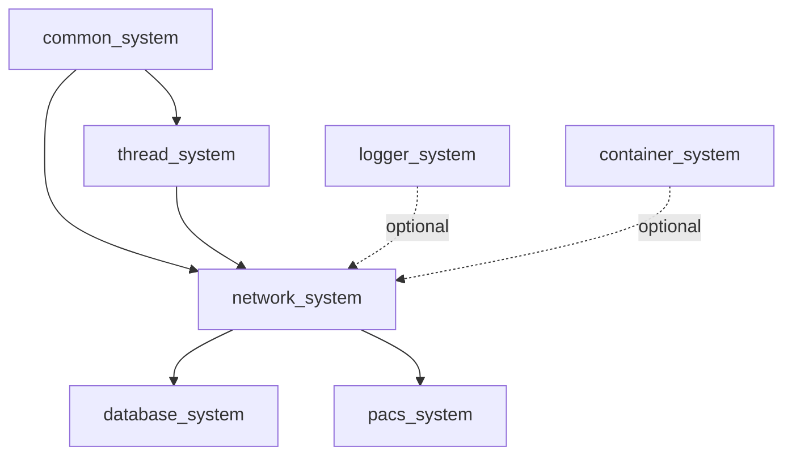

[](https://github.com/kcenon/network_system/actions/workflows/ci.yml)
[](https://github.com/kcenon/network_system/actions/workflows/code-quality.yml)
[](https://github.com/kcenon/network_system/actions/workflows/coverage.yml)
[](https://codecov.io/gh/kcenon/network_system)
[](https://github.com/kcenon/network_system/actions/workflows/build-Doxygen.yaml)
[](https://github.com/kcenon/network_system/blob/main/LICENSE)

# Network System

> **Language:** **English** | [한국어](README.kr.md)

## Table of Contents

- [Overview](#overview)
- [Quick Start](#quick-start-1)
- [Requirements](#requirements)
- [Installation via vcpkg](#installation-via-vcpkg)
- [Modular Architecture](#modular-architecture-new)
- [Core Features](#core-features)
- [Performance Highlights](#performance-highlights)
- [Architecture Overview](#architecture-overview)
- [Ecosystem Integration](#ecosystem-integration)
- [Documentation](#documentation)
- [Platform Support](#platform-support)
- [Production Quality](#production-quality)
- [Build Options](#build-options)
- [Examples](#examples)
- [Roadmap](#roadmap)
- [Contributing](#contributing)
- [License](#license)

---

## Overview

A modern C++20 asynchronous network library providing reusable transport primitives for distributed systems and messaging applications. Originally extracted from messaging_system for enhanced modularity and ecosystem-wide reusability.

**Key Characteristics**:
- 🏗️ **Modular Architecture**: Coroutine-friendly async I/O with pluggable protocol stack
- ⚡ **High Performance**: ASIO-based non-blocking operations; [historical CPU-only allocation/copy benchmarks](docs/BENCHMARKS.md#synthetic-benchmarks) report ~769K msg/s for 64-byte payloads
- 🛡️ **Production Grade**: Comprehensive sanitizer coverage (TSAN/ASAN/UBSAN clean), RAII Grade A, multi-platform CI/CD
- 🔒 **Secure**: TLS 1.2/1.3 support, certificate validation, modern cipher suites
- 🌐 **Cross-Platform**: Ubuntu, Windows, macOS with GCC, Clang, MSVC support

> **Version status — v1.0 candidate (tag pending).** The current package version
> is **`0.1.1`** (see `CMakeLists.txt` and `vcpkg.json`). The public API surface
> has been audited and *frozen as a v1.0 candidate*
> (see [docs/v1.0-api-surface.md](docs/v1.0-api-surface.md)), but **v1.0.0 has
> not been released and the `v1.0.0` tag has not been published.** The tag is
> tracked by the release-policy work in [#1165](https://github.com/kcenon/network_system/issues/1165)
> (coverage policy and upstream release prerequisites) and the readiness epic
> [#964](https://github.com/kcenon/network_system/issues/964). Until v1.0.0 is
> tagged, treat `network_system` as pre-1.0: the SemVer stability guarantees
> described below apply only once the tag ships.

> **Published release:** [v0.1.1](https://github.com/kcenon/network_system/releases/tag/v0.1.1).
> Its tagged CMake version is `0.1.1`, but both tagged vcpkg manifests still say
> `0.1.0`. See the [release erratum and policy](ci/RELEASE_POLICY.md#published-versions-and-historical-erratum)
> for the source comparison and next-release requirements.

---

## Installation via vcpkg

### Quick Start

```bash
# Using overlay ports from the kcenon vcpkg registry
vcpkg install kcenon-network-system \
  --overlay-ports=path/to/kcenon/vcpkg-registry/ports

# Optional logger integration (TLS is a core dependency)
vcpkg install "kcenon-network-system[logging]" \
  --overlay-ports=path/to/kcenon/vcpkg-registry/ports
```

> **Registry-based consumption**: For projects already using [kcenon/vcpkg-registry](https://github.com/kcenon/vcpkg-registry), add the registry to your `vcpkg-configuration.json` and install without `--overlay-ports`.

### Feature Matrix

These are features of the [registry port](https://github.com/kcenon/vcpkg-registry/blob/main/ports/kcenon-network-system/vcpkg.json), which downloads the published `v0.1.1` source. The root development manifest's `ssl`, `ecosystem`, `testing`, `samples`, and `docs` features are not consumer port features.

| Feature | Default | Description |
|---------|---------|-------------|
| core | always | common_system, thread_system, ASIO, OpenSSL, zlib |
| `logging` | off | Optional logger_system integration |

The CMake and C++ examples below target **current `main`, built and installed from source**. Do not assume that the published tag contains every current API. Install the dependency packages first, then follow the source build instructions below.

### CMake Integration

```cmake
cmake_minimum_required(VERSION 3.20)
project(readme_example LANGUAGES CXX)
find_package(network_system CONFIG REQUIRED)
add_executable(readme_example main.cpp)
target_compile_features(readme_example PRIVATE cxx_std_20)
target_link_libraries(readme_example PRIVATE network_system::network_system)
```

The canonical export target is `network_system::network_system`. This name is
the intended v1.0 stable-contract target for downstream consumers (the v1.0
guarantee takes effect once the v1.0.0 tag ships — see the version-status note
above) and is already provided consistently across both build-tree (FetchContent
/ add_subdirectory) and install-tree (`find_package`) consumption. No deprecated
target spellings are exported.

Save one of the C++ examples below as `main.cpp` and the block above as `CMakeLists.txt`. Set `CMAKE_PREFIX_PATH` to the installation prefixes of network_system and its dependencies.

```bash
cmake -S . -B build -DCMAKE_PREFIX_PATH="/path/to/network/install;/path/to/dependency/prefix"
cmake --build build --parallel
```

### Minimal Example

```cpp
#include <kcenon/network/facade/tcp_facade.h>
#include <iostream>

int main() {
    kcenon::network::facade::tcp_facade tcp;
    auto created = tcp.create_server({.port = 9090});
    if (created.is_err()) {
        std::cerr << created.error().message << '\n';
        return 1;
    }
    auto server = created.value();
    auto started = server->start(9090);
    if (started.is_err()) {
        std::cerr << started.error().message << '\n';
        return 1;
    }
    std::cout << "Listening on port 9090; press Enter to stop." << std::endl;
    std::cin.get();
    auto stopped = server->stop();
    return stopped.is_err() ? 1 : 0;
}
```

---

## Requirements

| Dependency | Version | Required | Description |
|------------|---------|----------|-------------|
| C++20 Compiler | GCC 13+ / Clang 17+ / MSVC 2022+ / Apple Clang 14+ | Yes | Higher requirements due to thread_system dependency |
| CMake | 3.20+ | Yes | Build system |
| ASIO | 1.30.2+ | Yes | Asynchronous I/O (standalone) |
| OpenSSL | 3.0+ | Yes | TLS/SSL support |
| [common_system](https://github.com/kcenon/common_system) | latest | Yes | Common interfaces and Result<T> |
| [thread_system](https://github.com/kcenon/thread_system) | latest | Yes | Thread pool and async operations |
| [logger_system](https://github.com/kcenon/logger_system) | latest | Optional | Default OFF; runtime binding through common_system ILogger |
| [container_system](https://github.com/kcenon/container_system) | latest | Optional | CMake default ON; disabled if the package is unavailable |

> **OpenSSL note**: The default TLS build requires OpenSSL 3.0 or later.

### Dependency Flow

```
network_system
├── common_system (required)
├── thread_system (required)
│   └── common_system
├── logger_system (optional, default OFF)
│   └── common_system
└── container_system (optional, default ON)
    └── common_system
```

> **Note**: Unlike database_system, network_system does **not** have a compile-time dependency on monitoring_system. For observability, network_system uses EventBus-based metric publishing via common_system. External monitoring consumers (including monitoring_system) can subscribe to `network_metric_event` for metrics collection. See [Monitoring Integration Guide](docs/integration/with-monitoring.md) for details.

### Building with Dependencies

Before building, install the CMake packages for `common_system`, `thread_system`, and ASIO, plus OpenSSL/zlib. Replace `CMAKE_PREFIX_PATH` with their actual installation prefixes. Cloning dependency repositories alone does not build their static libraries. This recipe disables optional logger/container integration.

```bash
git clone --branch main https://github.com/kcenon/network_system.git
cd network_system
cmake -S . -B build -G Ninja -DCMAKE_BUILD_TYPE=Release \
  -DCMAKE_PREFIX_PATH="/path/to/dependency/prefix" \
  -DBUILD_TESTS=OFF -DBUILD_EXAMPLES=OFF \
  -DKCENON_WITH_LOGGER_SYSTEM=OFF -DKCENON_WITH_CONTAINER_SYSTEM=OFF
cmake --build build --parallel
cmake --install build --prefix "$HOME/.local"
```

📖 **[Quick Start Guide →](docs/guides/QUICK_START.md)**

---

## Quick Start

### Prerequisites

These commands install system libraries. Check that distribution package versions meet the requirements; provide the C++ compiler and common_system/thread_system/ASIO CMake packages separately.

**Ubuntu/Debian** (Ubuntu 22.04+ provides OpenSSL 3.x by default):
```bash
sudo apt update
sudo apt install -y cmake ninja-build libasio-dev libssl-dev liblz4-dev zlib1g-dev
```

**macOS** (OpenSSL 3.x via Homebrew):
```bash
brew install cmake ninja asio openssl@3 lz4 zlib
```

**Windows (vcpkg)**:
```powershell
# vcpkg provides OpenSSL 3.x
vcpkg install openssl asio lz4 zlib --triplet x64-windows
```

**Windows (MSYS2)**:
```bash
pacman -S mingw-w64-x86_64-cmake mingw-w64-x86_64-ninja \
          mingw-w64-x86_64-asio mingw-w64-x86_64-openssl
```

### Build

Use the dependency installation and source build recipe above. Build the C++ examples in a separate consumer project against the installed package.

### C++20 Module Build (Experimental)

`NETWORK_BUILD_MODULES` enables a separate experimental module target. It requires CMake 3.28 or later and a module-capable toolchain; its interface is not interchangeable with the header API. See [src/modules](src/modules/) for the current interfaces. The quick-start examples below use the header API.

### Your First Server (60 seconds)

```cpp
#include <kcenon/network/network_system.h>
#include <iostream>
#include <memory>

int main() {
    auto server = std::make_shared<kcenon::network::core::messaging_server>("MyServer");

    auto result = server->start_server(8080);
    if (result.is_err()) {
        const auto& err = result.error();
        std::cerr << "Failed to start: " << err.message
                  << " (code: " << err.code << ")" << std::endl;
        return -1;
    }

    std::cout << "Server running on port 8080; press Enter to stop." << std::endl;
    std::cin.get();
    auto stopped = server->stop_server();
    return stopped.is_err() ? 1 : 0;
}
```

### Your First Client

```cpp
#include <kcenon/network/network_system.h>
#include <chrono>
#include <cstdint>
#include <iostream>
#include <memory>
#include <string>
#include <thread>
#include <utility>
#include <vector>

int main() {
    auto client = std::make_shared<kcenon::network::core::messaging_client>("MyClient");

    auto result = client->start_client("127.0.0.1", 8080);
    if (result.is_err()) {
        const auto& err = result.error();
        std::cerr << "Failed to connect: " << err.message
                  << " (code: " << err.code << ")" << std::endl;
        return -1;
    }

    // start_client initiates an asynchronous connection. Wait before sending.
    const auto deadline = std::chrono::steady_clock::now() + std::chrono::seconds(5);
    while (!client->is_connected() && std::chrono::steady_clock::now() < deadline) {
        std::this_thread::sleep_for(std::chrono::milliseconds(10));
    }
    if (!client->is_connected()) {
        std::cerr << "Connection timed out\n";
        (void)client->stop_client();
        return 1;
    }

    // Send message (std::move avoids extra copies)
    std::string message = "Hello, Network System!";
    std::vector<uint8_t> data(message.begin(), message.end());

    auto send_result = client->send_packet(std::move(data));
    if (send_result.is_err()) {
        const auto& err = send_result.error();
        std::cerr << "Failed to send: " << err.message
                  << " (code: " << err.code << ")" << std::endl;
    }

    std::cout << "Press Enter to stop the client." << std::endl;
    std::cin.get();
    auto stopped = client->stop_client();
    return send_result.is_err() || stopped.is_err() ? 1 : 0;
}
```

### Simplified Facade API

For even simpler usage, use the Facade API that hides template complexity:

```cpp
#include <kcenon/network/facade/tcp_facade.h>
#include <iostream>

int main() {
    kcenon::network::facade::tcp_facade tcp;
    auto created = tcp.create_server({.port = 8080});
    if (created.is_err()) {
        std::cerr << created.error().message << '\n';
        return 1;
    }
    auto server = created.value();
    server->set_receive_callback([](auto session_id, const auto& data) {
        std::cout << "Received " << data.size() << " bytes from "
                  << session_id << std::endl;
    });
    auto started = server->start(8080);
    if (started.is_err()) {
        std::cerr << started.error().message << '\n';
        return 1;
    }
    std::cout << "Listening on port 8080; press Enter to stop." << std::endl;
    std::cin.get();
    auto stopped = server->stop();
    return stopped.is_err() ? 1 : 0;
}
```

**Benefits:**
- ✅ No template parameters
- ✅ Clear configuration struct
- ✅ Protocol-agnostic interface
- ✅ Same performance as direct API

📖 **[Full Facade Documentation →](docs/facades/README.md)**

---

## Modular Architecture (NEW)

The current source tree is organized into protocol-specific libraries for improved maintainability and selective linking.

### Library Overview

| Library | Description | Dependencies |
|---------|-------------|--------------|
| [`network-core`](libs/network-core/) | Core interfaces and session management | None |
| [`network-tcp`](libs/network-tcp/) | TCP protocol with SSL/TLS support | network-core, ASIO, OpenSSL |
| [`network-udp`](libs/network-udp/) | UDP datagram protocol | network-core, ASIO |
| [`network-websocket`](libs/network-websocket/) | WebSocket (RFC 6455) | network-tcp |
| [`network-http2`](libs/network-http2/) | HTTP/2 multiplexed protocol | network-websocket |
| [`network-quic`](libs/network-quic/) | QUIC (RFC 9000) | network-udp, OpenSSL |
| [`network-grpc`](libs/network-grpc/) | gRPC high-performance RPC | network-quic |
| [`network-all`](libs/network-all/) | Umbrella package (all protocols) | All above |

### Protocol Support Status

Audited support status per protocol (see
[docs/PROTOCOL_SUPPORT.md](docs/PROTOCOL_SUPPORT.md) for the full matrix,
evidence, and code-level findings):

| Protocol | Status | Notes |
|----------|--------|-------|
| TCP | `production` | Async server/client, lifecycle, reconnection |
| UDP | `production` | Connectionless datagram, broadcast/multicast |
| TLS/SSL | `production` | TLS 1.2/1.3, certificate validation |
| WebSocket | `production` | RFC 6455 framing, fragmentation, ping/pong |
| HTTP/1.1 | `production` | Routing, cookies, multipart, gzip/deflate |
| HTTP/2 | `production` | Multiplexed streams; HPACK Huffman coding (see the protocol support matrix) |
| QUIC | `production` | RFC 9000/9001/9002 core; experimental client stats/ALPN accessors |
| gRPC | `production` | Custom HTTP/2 transport + optional `grpc++` wrapper |
| DTLS | `experimental` | Socket present and tested; server payload handling not yet wired |

`production` protocols are covered by happy-path and non-happy-path tests.
`experimental` surfaces are documented and excluded from the (candidate) v1.0
stability surface; the v1.0 guarantee itself takes effect only once the v1.0.0
tag ships (see the version-status note in [Overview](#overview)).

### Dependency Graph

```
                    network-core
                    /    |    \
                   /     |     \
            network-tcp  |  network-udp
                  |      |      |
         network-websocket    network-quic
                  |             |
              network-http2  network-grpc
```

### Selective Linking

Link only the protocols your application needs:

Use the same `main.cpp`/`CMakeLists.txt` consumer layout above. The top-level installation exports protocol targets through the `network_system` package. This block is for programs using TCP/UDP headers; use `network_system::network_system` for the umbrella example below.

```cmake
cmake_minimum_required(VERSION 3.20)
project(protocol_example LANGUAGES CXX)
find_package(network_system CONFIG REQUIRED)
add_executable(protocol_example main.cpp)
target_compile_features(protocol_example PRIVATE cxx_std_20)
target_link_libraries(protocol_example PRIVATE
    network_system::network-tcp
    network_system::network-udp
)
```

`main.cpp` for the protocol targets above:

```cpp
#include <network_tcp/protocol/tcp.h>
#include <network_udp/protocol/udp.h>

int main() {
    auto tcp = kcenon::network::protocol::tcp::create_connection("readme-tcp");
    auto udp = kcenon::network::protocol::udp::create_connection("readme-udp");
    return tcp && udp ? 0 : 1;
}
```

### Umbrella Header

Use the public aggregate header for core networking and the facade header for TCP construction:

```cpp
#include <kcenon/network/network_system.h>
#include <kcenon/network/facade/tcp_facade.h>

int main() {
    kcenon::network::facade::tcp_facade tcp;
    auto server = tcp.create_server({.port = 8080});
    return server.is_err() ? 1 : 0;
}
```

📖 **[Migration Guide →](docs/MIGRATION.md)** | **[Library READMEs](libs/)**

---

## Core Features

### Protocols

- **TCP**: Asynchronous TCP server/client with lifecycle management
  - Non-blocking I/O, automatic reconnection, health monitoring
  - Multi-threaded message processing, session management

- **UDP**: Connectionless UDP for real-time applications
  - Low-latency datagram transmission, broadcast/multicast support

- **TLS/SSL**: Secure communication (TLS 1.2/1.3)
  - Modern cipher suites (AES-GCM, ChaCha20-Poly1305)
  - Certificate validation, forward secrecy (ECDHE)

- **WebSocket**: RFC 6455 compliant
  - Text and binary message framing, ping/pong keepalive
  - Fragmentation/reassembly, graceful connection lifecycle

- **HTTP/1.1**: Server and client with advanced features
  - Routing, cookies, multipart/form-data, chunked encoding
  - Automatic compression (gzip/deflate)

- **QUIC**: RFC 9000/9001/9002 compliant
  - UDP-based multiplexed transport with TLS 1.3 encryption
  - Stream multiplexing, 0-RTT connection resumption
  - Loss detection and congestion control
  - Connection migration support

- **gRPC**: High-performance RPC framework (NEW)
  - Official gRPC library wrapper with network_system integration
  - Service registry with dynamic method registration
  - All streaming modes (unary, server, client, bidirectional)
  - Health checking and reflection support
  - Result<T> to gRPC Status conversion

📖 **[Detailed Protocol Documentation →](docs/FEATURES.md)**
📖 **[gRPC Guide →](docs/guides/GRPC_GUIDE.md)**

### Distributed Tracing

OpenTelemetry-compatible distributed tracing for observability:

- **W3C Trace Context**: Standard context propagation across service boundaries
- **RAII Spans**: Automatic span lifecycle management with `NETWORK_TRACE_SPAN` macro
- **Exporters**: Console and OTLP HTTP; other exporter backends have limitations documented in the [protocol support matrix](docs/PROTOCOL_SUPPORT.md)
- **Sampling**: Always-on, always-off, trace-id-based, parent-based samplers
- **Rich Attributes**: String, integer, double, boolean attributes and events

```cpp
#include <kcenon/network/tracing/tracing.h>

using namespace kcenon::network::tracing;

void process_request() {
    NETWORK_TRACE_SPAN("http.request.process");
    _span.set_attribute("http.method", "POST");
    _span.set_attribute("http.url", "/api/orders");
    {
        auto db_span = trace_context::current().create_child_span("database.query");
        db_span.set_attribute("db.system", "postgresql");
        db_span.set_status(span_status::ok);
    }
    _span.set_status(span_status::ok);
}

int main() {
    auto config = tracing_config::console();
    config.service_name = "my-service";
    configure_tracing(config);
    process_request();
    shutdown_tracing();
}
```

📖 **[Tracing Guide →](docs/guides/tracing.md)**

### Asynchronous Model

- **ASIO-Based**: Non-blocking event loop with async operations
- **C++20 Coroutines**: Optional coroutine-based async helpers
- **C++20 Concepts**: Compile-time type validation with clear error messages
- **Pipeline Architecture**: Message transformation with compression/encryption hooks
- **Move Semantics**: Zero-copy friendly APIs (move-aware buffer handling)

### Failure Handling
- All server/client start helpers return `Result<void>`; check `result.is_err()` before continuing and log `result.error().message`.
- For historical fixes (session cleanup, backpressure, TLS rollout), consult the [design decisions](docs/DESIGN_DECISIONS.md) and [issue tracker](https://github.com/kcenon/network_system/issues).
- When building higher-level services, propagate `common::error_info` up the stack so monitoring and alerting pipelines can correlate failures across tiers.

### Error Handling

**Result<T> Pattern** (75-80% migrated):
This fragment belongs inside `main()` of the server example above, immediately after creating `server`.

```cpp
auto result = server->start_server(8080);
if (result.is_err()) {
    const auto& err = result.error();
    std::cerr << "Error: " << err.message
              << " (code: " << err.code << ")\n";
    return -1;
}
```

**Error Codes** (-600 to -699):
- Connection (-600 to -619): `connection_failed`, `connection_refused`, `connection_timeout`
- Session (-620 to -639): `session_not_found`, `session_expired`
- Send/Receive (-640 to -659): `send_failed`, `receive_failed`, `message_too_large`
- Server (-660 to -679): `server_not_started`, `server_already_running`, `bind_failed`

---

## Performance Highlights

### Synthetic Benchmarks (Intel i7-12700K, Ubuntu 22.04, GCC 11, `-O3`)

These historical GCC 11.3 measurements come from the [benchmark record](docs/BENCHMARKS.md#synthetic-benchmarks); they do not establish support for GCC 11 in the current source, which requires GCC 13 or later. They measure CPU-only allocation/memcpy, not network throughput.

| Payload | Throughput | Latency (ns/op) | Scope |
|---------|-----------|-----------------|-------|
| 64 bytes | ~769K msg/s | 1,300 | CPU-only (allocation + memcpy) |
| 256 bytes | ~305K msg/s | 3,270 | CPU-only (allocation + memcpy) |
| 1 KB | ~128K msg/s | 7,803 | CPU-only (allocation + memcpy) |
| 8 KB | ~21K msg/s | 48,000 | CPU-only (allocation + memcpy) |

### Real I/O Benchmarks (Loopback TCP)

| Benchmark | Payload | Scope |
|-----------|---------|-------|
| TCP Connection Establish | N/A | Connect + disconnect via loopback |
| TCP Echo Roundtrip | 64B, 1KB, 8KB | Send + receive through kernel TCP stack |
| TCP Stream Throughput | 1KB, 64KB | Sustained bytes/sec over loopback |

**Note**: Synthetic benchmarks measure CPU-only operations without real network I/O. Real I/O benchmarks use a TCP echo server on the loopback interface to measure actual kernel TCP stack overhead.

### Reproducing Benchmarks

Benchmark targets are created only when the Google Benchmark package is found; `NETWORK_BUILD_BENCHMARKS=ON` does not install that dependency. See the [benchmark sources and CMake configuration](benchmarks/) and [measurement methodology](docs/BENCHMARKS.md).

⚡ **[Full Benchmarks & Load Testing →](docs/BENCHMARKS.md)**

**Platform**: Apple M1 @ 3.2GHz (when tested on Apple Silicon)

---

## Architecture Overview

```
┌─────────────────────────────────────────────────────────────────┐
│                    Network System Architecture                  │
├─────────────────────────────────────────────────────────────────┤
│  Public API Layer                                               │
│  ┌──────────────┐ ┌──────────────┐ ┌──────────────────────┐    │
│  │ messaging    │ │ messaging    │ │  messaging_ws        │    │
│  │ _server      │ │ _client      │ │  _server / _client   │    │
│  │ (TCP)        │ │ (TCP)        │ │  (WebSocket)         │    │
│  └──────────────┘ └──────────────┘ └──────────────────────┘    │
│  ┌──────────────────────┐ ┌─────────────────────────┐          │
│  │ secure_messaging     │ │ secure_messaging        │          │
│  │ _server (TLS/SSL)    │ │ _client (TLS/SSL)       │          │
│  └──────────────────────┘ └─────────────────────────┘          │
│  ┌──────────────────────┐ ┌─────────────────────────┐          │
│  │ messaging_quic       │ │ messaging_quic          │          │
│  │ _server (QUIC)       │ │ _client (QUIC)          │          │
│  └──────────────────────┘ └─────────────────────────┘          │
├─────────────────────────────────────────────────────────────────┤
│  Protocol Layer                                                 │
│  ┌──────────────┐ ┌──────────────┐ ┌──────────────────────┐    │
│  │ tcp_socket   │ │ udp_socket   │ │ websocket_socket     │    │
│  └──────────────┘ └──────────────┘ └──────────────────────┘    │
│  ┌──────────────────────┐ ┌──────────────────────────────┐     │
│  │ secure_tcp_socket    │ │ websocket_protocol           │     │
│  │ (SSL stream wrapper) │ │ (frame/handshake/msg handle) │     │
│  └──────────────────────┘ └──────────────────────────────┘     │
│  ┌──────────────────────────────────────────────────────────┐  │
│  │ protocols/quic/ (RFC 9000/9001/9002)                     │  │
│  │ connection, stream, packet, frame, crypto, varint        │  │
│  └──────────────────────────────────────────────────────────┘  │
├─────────────────────────────────────────────────────────────────┤
│  Session Management Layer                                       │
│  ┌──────────────┐ ┌──────────────┐ ┌────────────────────────┐  │
│  │ messaging    │ │ secure       │ │ ws_session_manager     │  │
│  │ _session     │ │ _session     │ │ (WebSocket mgmt)       │  │
│  │ (TCP)        │ │ (TLS/SSL)    │ │                        │  │
│  └──────────────┘ └──────────────┘ └────────────────────────┘  │
│  ┌────────────────────────────────────────────────────────────┐│
│  │ quic_session (QUIC session management)                     ││
│  └────────────────────────────────────────────────────────────┘│
├─────────────────────────────────────────────────────────────────┤
│  Core Network Engine (ASIO-based)                              │
│  ┌─────────────┐ ┌─────────────┐ ┌─────────────┐              │
│  │ io_context  │ │   async     │ │  Result<T>  │              │
│  │             │ │  operations │ │   pattern   │              │
│  └─────────────┘ └─────────────┘ └─────────────┘              │
└─────────────────────────────────────────────────────────────────┘
```

**Design Patterns**: Factory, Observer, Strategy, RAII, Template Metaprogramming

🏛️ **[Detailed Architecture Guide →](docs/ARCHITECTURE.md)**

---

## Ecosystem Integration

### Ecosystem Dependency Map



> **Ecosystem reference**:
> [common_system](https://github.com/kcenon/common_system) — Result&lt;T&gt;, interfaces, and shared utilities
> [thread_system](https://github.com/kcenon/thread_system) — Thread pool and async execution primitives
> [container_system](https://github.com/kcenon/container_system) — Type-safe data serialization
> [logger_system](https://github.com/kcenon/logger_system) — Logging infrastructure
> [database_system](https://github.com/kcenon/database_system) — Database operations (depends on network_system)
> [pacs_system](https://github.com/kcenon/pacs_system) — DICOM/PACS system (consumes network_system)

### Related Projects

This system integrates seamlessly with:

- **[messaging_system](https://github.com/kcenon/messaging_system)**: High-performance message routing and delivery
- **[container_system](https://github.com/kcenon/container_system)**: Type-safe data serialization (MessagePack, FlatBuffers)
- **[thread_system](https://github.com/kcenon/thread_system)**: Thread pool management for concurrent operations
- **[logger_system](https://github.com/kcenon/logger_system)**: Comprehensive network diagnostics and logging
- **[database_system](https://github.com/kcenon/database_system)**: Network-based database operations and clustering

### Integration Example

```cpp
#include <kcenon/network/integration/thread_integration.h>
#include <iostream>
#include <memory>

int main() {
    using namespace kcenon::network::integration;
    auto pool = std::make_shared<basic_thread_pool>(2);
    auto& manager = thread_integration_manager::instance();
    manager.set_thread_pool(pool);
    manager.submit_task([] { std::cout << "Task completed\n"; }).get();
    std::cout << "Workers: " << manager.get_metrics().worker_threads << '\n';
    pool->stop();
}
```

### Custom Thread Pools

To connect an external executor, implement the public `integration::thread_pool_interface` and register it with `thread_integration_manager::set_thread_pool()`. The example above uses the supplied `basic_thread_pool`. Adapters under `src/internal/integration` are implementation details, not public application headers.

🌐 **[Full Integration Guide →](docs/INTEGRATION.md)**

---

## Documentation

### Getting Started
- 📖 [Features Guide](docs/FEATURES.md) - Comprehensive feature descriptions
- 🏗️ [Architecture](docs/ARCHITECTURE.md) - System design and patterns
- 📘 [API Reference](docs/API_REFERENCE.md) - Complete API documentation
- 🔧 [Build Guide](docs/guides/BUILD.md) - Detailed build instructions
- 🚀 [Migration Guide](docs/MIGRATION.md) - Migrating from messaging_system

#### Generated API Docs (Doxygen)

The full Doxygen-generated reference for the (candidate) v1.0 public API surface
is published from the `main` branch by the
[Generate-Documentation workflow](.github/workflows/build-Doxygen.yaml) and
hosted on GitHub Pages at:

- https://kcenon.github.io/network_system/

To regenerate the HTML locally:

```bash
doxygen Doxyfile
# Output: documents/html/index.html
```

The
[Doxygen Warnings Check workflow](.github/workflows/doxygen-warnings-check.yml)
runs on PRs changing `include/**`, `Doxyfile`, or the workflow itself,
and on pushes to `main`, `develop`, or `phase-*`. It fails if a header under
`include/kcenon/network/` (excluding `detail/`) emits a Doxygen warning.
This guards the v1.0 public API surface defined in
[docs/v1.0-api-surface.md](docs/v1.0-api-surface.md) against documentation
regressions.

### Advanced Topics
- ⚡ [Performance & Benchmarks](docs/BENCHMARKS.md) - Performance metrics and testing
- 🏭 [Production Quality](docs/PRODUCTION_QUALITY.md) - CI/CD, security, quality assurance
- 📁 [Project Structure](docs/PROJECT_STRUCTURE.md) - Directory organization and modules
- 🧩 [C++20 Concepts](docs/advanced/CONCEPTS.md) - Compile-time type validation
- 🔒 [TLS Setup Guide](docs/guides/TLS_SETUP_GUIDE.md) - TLS/SSL configuration
- 🔍 [Troubleshooting](docs/guides/TROUBLESHOOTING.md) - Common issues and solutions
- 🧪 [Load Test Guide](docs/guides/LOAD_TEST_GUIDE.md) - Load testing procedures
- 📝 [Design Decisions](docs/DESIGN_DECISIONS.md) - Architectural patterns and rationale

### Development
- 🔄 [Integration Guide](docs/INTEGRATION.md) - Ecosystem integration patterns
- 📊 [Operations Guide](docs/advanced/OPERATIONS.md) - Deployment and operations
- 📋 [Changelog](docs/CHANGELOG.md) - Version history and updates

---

## Platform Support

| Platform | Compiler | Architecture | Support Level |
|----------|----------|--------------|---------------|
| Ubuntu 22.04+ | GCC 13+ | x86_64, ARM64 | ✅ Full Support |
| Ubuntu 22.04+ | Clang 17+ | x86_64, ARM64 | ✅ Full Support |
| Windows 2022+ | MSVC 2022+ | x86_64 | ✅ Full Support |
| Windows 2022+ | MinGW64 | x86_64 | ✅ Full Support |
| macOS 12+ | Apple Clang 14+ | x86_64, ARM64 | ✅ Full Support |

---

## Production Quality

### CI/CD Infrastructure

**Comprehensive Multi-Platform Testing**:
- ✅ **Sanitizer Coverage**: ThreadSanitizer, AddressSanitizer, UBSanitizer
- ✅ **Multi-Platform**: Ubuntu (GCC/Clang), Windows (MSVC/MinGW), macOS
- ✅ **Performance Gates**: Automated regression detection
- ✅ **Static Analysis**: clang-tidy, cppcheck with modernize checks
- ✅ **Code Coverage**: ~80% with Codecov integration

### Security

**TLS/SSL Implementation**:
- TLS 1.2/1.3 protocol support
- Modern cipher suites (AES-GCM, ChaCha20-Poly1305)
- Forward secrecy (ECDHE), certificate validation
- Hostname verification, optional certificate pinning

**Additional Security**:
- Input validation and buffer overflow protection
- WebSocket origin validation and frame masking
- HTTP request size limits and path traversal protection
- Cookie security (HttpOnly, Secure, SameSite)

### Thread Safety & Memory Safety

**Thread Safety**:
- ✅ Comprehensive synchronization (mutex, atomic, shared_mutex)
- ✅ ThreadSanitizer clean (zero data races)
- ✅ Concurrent session handling tested

**Memory Safety** (RAII Grade A):
- ✅ 100% smart pointer usage (`std::shared_ptr`, `std::unique_ptr`)
- ✅ Zero manual memory management
- ✅ AddressSanitizer clean (zero leaks, zero buffer overflows)
- ✅ Automatic resource cleanup via RAII

🛡️ **[Complete Production Quality Guide →](docs/PRODUCTION_QUALITY.md)**

---

## Dependencies

The Requirements table above is the dependency reference. The default source build uses C++20, CMake 3.20+, standalone ASIO 1.30.2+, OpenSSL 3.0+, zlib, and installed common_system/thread_system packages. Boost.ASIO is not a substitute for standalone ASIO.

logger_system is an optional runtime integration, disabled by default. container_system discovery defaults to ON, but integration is disabled when the package is absent. LZ4 is optional compression support when installed. The top-level build does not directly require fmt.

---

## Build Options

### Using CMake Presets (Recommended)

CMake presets provide standardized build configurations:

Reading preset schema 6 requires CMake 3.25 or later. `asan`, `tsan`, and `ubsan` have matching test presets. `release` and `coverage` do not; run CTest from their build directory.

```bash
cmake --list-presets
# Choose one configure/build preset: debug, release, asan, tsan, ubsan, coverage.
# Substitute the same name in both commands.
cmake --preset debug -DBUILD_EXAMPLES=OFF \
  -DCMAKE_PREFIX_PATH="/path/to/dependency/prefix" \
  -DKCENON_WITH_LOGGER_SYSTEM=OFF -DKCENON_WITH_CONTAINER_SYSTEM=OFF
cmake --build --preset debug
ctest --preset debug
```

### Manual CMake Configuration

```bash
# Configure a separate directory for each sanitizer/profile.
cmake -S . -B build/debug -DCMAKE_BUILD_TYPE=Debug \
  -DCMAKE_PREFIX_PATH="/path/to/dependency/prefix" \
  -DBUILD_TESTS=ON -DBUILD_EXAMPLES=OFF \
  -DKCENON_WITH_LOGGER_SYSTEM=OFF -DKCENON_WITH_CONTAINER_SYSTEM=OFF
cmake --build build/debug --parallel
ctest --test-dir build/debug --output-on-failure --timeout 120
```

### Cleaning Build Directories

To remove all build directories at once:

```bash
./scripts/clean.sh
```

> **Tip**: Prefer `cmake --preset <name>` over manual `mkdir build_*` directories.
> Named presets produce consistent, reproducible builds and avoid build directory proliferation.

### Available CMake Options

| Option | Default | Description |
|--------|---------|-------------|
| `BUILD_TESTS` | ON | Build unit tests |
| `BUILD_EXAMPLES` | ON | Build usage examples |
| `BUILD_TLS_SUPPORT` | ON | Enable TLS/SSL support |
| `BUILD_WEBSOCKET_SUPPORT` | ON | Enable WebSocket protocol |
| `NETWORK_BUILD_BENCHMARKS` | OFF | Build performance benchmarks |
| `ENABLE_ASAN` | OFF | Enable AddressSanitizer |
| `ENABLE_TSAN` | OFF | Enable ThreadSanitizer |
| `ENABLE_UBSAN` | OFF | Enable UndefinedBehaviorSanitizer |
| `ENABLE_COVERAGE` | OFF | Enable code coverage |
| `NETWORK_ENABLE_GRPC_OFFICIAL` | OFF | Use official gRPC library |

---

## Examples

These targets can be built individually from the current source:

| Source | CMake target |
|--------|--------------|
| [concepts_example.cpp](examples/concepts_example.cpp) | `example_concepts_example` |
| [thread_integration_example.cpp](examples/thread_integration_example.cpp) | `example_thread_integration_example` |
| [tls_policy_example.cpp](examples/tls_policy_example.cpp) | `example_tls_policy_example` |
| [http2_server_example.cpp](examples/http2_server_example.cpp) | `example_http2_server_example` |

Some other programs under `examples/` still use earlier APIs; select the target you need instead of building every example. The commands below reuse the source build directory with dependencies configured above.

```bash
cmake -S . -B build -DBUILD_EXAMPLES=ON
cmake --build build --target example_thread_integration_example
./build/bin/examples/example_thread_integration_example
```

---

## Roadmap

### Recently Completed
- ✅ **HTTP/2 client**: Implemented with tests; see the [protocol support matrix](docs/PROTOCOL_SUPPORT.md) for scope and limitations.
- ✅ **QUIC Protocol Support**: RFC 9000/9001/9002 compliant implementation
- ✅ **gRPC Integration**: Official gRPC library wrapper with full streaming support

### Current Focus
- 🚧 Real network load test validation and baseline establishment
- 🚧 Complete Result<T> migration (currently 75-80%)
- 🚧 Documentation examples update

### Planned Features
- 🚧 **Connection Pooling**: Enterprise-grade connection management
- 🚧 **Zero-Copy Pipelines**: Eliminate unnecessary buffer copies

See the [Changelog](docs/CHANGELOG.md) for completed work and in-progress items.

---

## Contributing

Contributions are welcome! Please see our [Contributing Guide](docs/contributing/CONTRIBUTING.md) for detailed guidelines.

1. Fork the repository
2. Create a feature branch (`git checkout -b feature/amazing-feature`)
3. Follow the [Contributing Guide](docs/contributing/CONTRIBUTING.md) and formatting in [.clang-format](.clang-format); run clang-format before committing.
4. Commit changes with conventional commits
5. Push to the branch (`git push origin feature/amazing-feature`)
6. Open a Pull Request

**Before submitting**:
- Ensure all tests pass (`ctest`)
- Run sanitizers (TSAN, ASAN, UBSAN)
- Check code formatting (`clang-format`)
- Update documentation as needed

---

## License

This project is licensed under the BSD 3-Clause License - see the [LICENSE](LICENSE) file for details.

---

## Contact & Support

| Contact Type | Details |
|--------------|---------|
| **Project Owner** | kcenon (kcenon@naver.com) |
| **Repository** | https://github.com/kcenon/network_system |
| **Issues & Bug Reports** | https://github.com/kcenon/network_system/issues |
| **Questions** | https://github.com/kcenon/network_system/issues |

---

## Acknowledgments

### Core Dependencies
- **ASIO Library Team**: Foundation of asynchronous network programming
- **C++ Standards Committee**: C++20 features enabling modern networking

### Ecosystem Integration
- **Thread System**: Seamless thread pool integration
- **Logger System**: Comprehensive logging and debugging
- **Container System**: Advanced serialization support
- **Database System**: Network-database integration patterns
- **Monitoring System**: Performance metrics and observability

---

<p align="center">
  Made with ❤️ by 🍀☀🌕🌥 🌊
</p>
